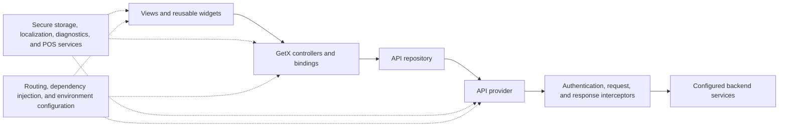

# O7Lite

O7Lite is a Flutter payment application built for Android point-of-sale (POS) terminals, standard Android devices, and iOS. It provides a shared mobile experience while retaining device-specific integrations through dedicated Android build flavors.

| Project | Value |
| --- | --- |
| Framework | Flutter and Dart |
| Application architecture | Feature-oriented modules with GetX and layered data access |
| Android application ID | `com.oxpay.o7lite` |
| iOS bundle ID | `com.oxpay.o7lite` |
| Supported targets | Android POS, Android mobile, and iOS |

## Product capabilities

The application includes the following source-backed capabilities:

- Terminal authentication and account onboarding
- Card and digital-payment workflows
- QR payment generation and QR or barcode scanning
- Transaction history, transaction details, refunds, and voids
- Transaction summaries, reports, and receipt delivery
- Hosted payment-link creation
- Integrated and Bluetooth receipt printing
- Device, network, Wi-Fi, and printer diagnostics
- Configurable language, appearance, sound, and terminal settings
- Device-aware behavior for supported POS terminal families

Availability can depend on the configured environment, terminal profile, merchant permissions, and target hardware.

## App design

O7Lite uses a shared presentation layer across phone and POS form factors. Responsive sizing utilities adapt spacing and controls to the active display, while reusable widgets keep payment, status, dialog, and navigation patterns consistent across features.

The application design includes:

- O7Lite visual resources organized under `assets/o7lite/`
- Light and dark presentation modes
- Centralized colors, typography, decorations, and theme helpers
- Localized interface copy with English fallback
- Explicit loading, success, warning, and failure feedback
- Adaptive splash and animation behavior for different device capabilities
- Full-screen Android operation designed for dedicated terminal use

Fifteen locale packs are currently included. The saved language is restored during application startup before the main interface is rendered.

## Architecture

The codebase follows a feature-oriented Flutter structure with GetX for state management, navigation, bindings, and dependency resolution. Data access is separated into repository and provider layers. The project does not claim strict clean-architecture boundaries; the diagram below reflects the implemented dependency flow.



### Application layers

| Layer | Responsibility |
| --- | --- |
| Views and widgets | Render screens, collect input, and present controller state |
| Controllers and bindings | Coordinate feature state, lifecycle, navigation, and dependency setup |
| Repository | Expose application-focused operations and map provider responses into models |
| Provider and interceptors | Configure transport, authentication, request metadata, response handling, and environment selection |
| Models | Define typed request and response structures with generated JSON serialization |
| Shared services | Provide secure persistence, printing, diagnostics, deep links, migrations, and device integration |
| Cross-cutting configuration | Supply routes, localization, themes, constants, and environment-specific behavior |

### Startup and request flow

At startup, the selected environment is loaded, local data migrations run, shared dependencies initialize, security checks execute, and the saved locale is restored. GetX then creates the application-level services and routes to the appropriate feature.

For a typical remote operation:

1. A view delegates an action to its feature controller.
2. The controller calls an application operation exposed by the repository.
3. The repository prepares typed request data and delegates transport to the API provider.
4. Interceptors attach authentication and request metadata and normalize response handling.
5. The controller updates observable state, and the view renders the result.

## Project structure

```text
assets/o7lite/       O7Lite images, icons, and sound resources
android/             Android host project, product flavors, and POS integrations
ios/                 iOS host project and platform configuration
docs/                Engineering, build, and maintenance notes
lib/
  api/               Providers, repositories, interceptors, and transport security
  lang/              Localization service and language resources
  models/            Typed request and response models
  modules/           Feature screens, controllers, bindings, and components
  routes/            GetX route names and page registration
  shared/            Constants, widgets, utilities, security, storage, and services
  theme/             Theme data, colors, typography, and decorations
test/                Unit, widget, security, storage, and integration-contract tests
```

## Platforms and Android flavors

Android builds use a `device` flavor dimension. Each target has a dedicated entry point so device integrations remain isolated while the Flutter feature layer stays shared.

| Flavor | Target | Entry point |
| --- | --- | --- |
| `mobile` | Standard Android devices | `lib/main_mobile.dart` |
| `sunmi` | Sunmi POS | `lib/main_sunmi.dart` |
| `landi` | Landi POS | `lib/main_landi.dart` |
| `castle` | Castle POS | `lib/main_castle.dart` |
| `anfu` | Anfu POS | `lib/main_anfu.dart` |
| `wizarpos` | WizarPOS Q2 | `lib/main_wizarpos.dart` |
| `coherent` | Coherent/Centerm POS | `lib/main_coherent.dart` |
| `morefun` | MoreFun POS | `lib/main_morefun.dart` |

iOS uses `lib/main_mobile.dart` without an Android product flavor.

Device-specific Android SDK requirements, version numbers, ABI configuration, and signing details are maintained in [`docs/DEV_NOTES.md`](docs/DEV_NOTES.md).

## Requirements

- Flutter SDK compatible with Dart `>=3.4.0 <4.0.0`
- Android SDK and Java 17 for Android development
- Xcode and CocoaPods for iOS development
- A physical supported terminal for validating hardware-specific integrations

This project targets ARM Android hardware. Confirm device and ABI requirements in the development notes before preparing a terminal release.

## Local setup

1. Create a local environment file:

   ```bash
   cp .env.example .env
   ```

2. Configure these values for the receiving environment:

   | Variable | Purpose |
   | --- | --- |
   | `USER_GUIDE_URL` | Customer-facing user guide |
   | `PRIVACY_POLICY_URL` | Published privacy policy |
   | `MERCHANT_DASHBOARD_URL` | Merchant dashboard entry point |
   | `SUPPORT_EMAIL` | Customer support contact |

   Keep environment-specific values local and distribute them through the customer's approved configuration channel.

3. Install Flutter dependencies:

   ```bash
   flutter pub get
   ```

4. Generate JSON serialization and environment source files:

   ```bash
   dart run build_runner build --delete-conflicting-outputs
   ```

5. For iOS development, install CocoaPods dependencies:

   ```bash
   cd ios
   pod install
   cd ..
   ```

## Run the application

### Android

Use the matching flavor and entry point:

```bash
flutter run --flavor mobile -t lib/main_mobile.dart
flutter run --flavor sunmi -t lib/main_sunmi.dart
flutter run --flavor landi -t lib/main_landi.dart
flutter run --flavor castle -t lib/main_castle.dart
flutter run --flavor anfu -t lib/main_anfu.dart
flutter run --flavor wizarpos -t lib/main_wizarpos.dart
flutter run --flavor coherent -t lib/main_coherent.dart
flutter run --flavor morefun -t lib/main_morefun.dart
```

### iOS

```bash
flutter run -t lib/main_mobile.dart
```

## Quality checks

Run static analysis and the automated test suite before delivery:

```bash
flutter analyze
flutter test
```

Regenerate ignored source files first if analysis reports missing generated serializers or environment configuration.

## Build examples

### Android debug APK

```bash
flutter build apk --debug --flavor mobile -t lib/main_mobile.dart
```

### Android release APK

```bash
flutter build apk --release --flavor sunmi -t lib/main_sunmi.dart \
  --obfuscate \
  --split-debug-info=build/debug-info/sunmi
```

### Android App Bundle

```bash
flutter build appbundle --release --flavor mobile -t lib/main_mobile.dart \
  --obfuscate \
  --split-debug-info=build/debug-info/mobile
```

### iOS unsigned debug build

```bash
flutter build ios --debug --no-codesign -t lib/main_mobile.dart
```

Release signing material must be supplied locally and must not be committed. See [`docs/DEV_NOTES.md`](docs/DEV_NOTES.md) for flavor versioning, output locations, signing configuration, and additional build commands.

## Security

The application includes layered protections appropriate to handling payment workflows:

- Root and jailbreak detection before normal application startup
- Encrypted local storage with migration from legacy persistence formats
- Session-aware authentication and request interception
- Transport configuration, cipher validation, and network security controls
- Hardened in-app WebView configuration
- Removal of locally stored sensitive session data when required
- Automated tests covering storage, network configuration, platform security, and device contracts

Security behavior must be revalidated for the customer's target environment, release signing configuration, and supported terminal models before production distribution.

## Repository hygiene

The repository intentionally excludes local configuration and generated artifacts, including:

- `.env` and local signing configuration
- Generated `*.g.dart` source files
- `pubspec.lock` and `ios/Podfile.lock`
- Flutter, Gradle, CocoaPods, and Xcode build outputs
- IDE metadata and temporary files

After cloning, run the setup and generation steps before analysis or compilation. Do not commit local credentials, keystores, provisioning profiles, generated build outputs, or customer-specific configuration.

## Maintenance

- Keep flavor entry points aligned with Android product-flavor definitions.
- Update translations together and preserve English as the fallback locale.
- Regenerate serialization code whenever annotated models change.
- Run analysis, tests, and a build for the affected target before release.
- Update [`docs/DEV_NOTES.md`](docs/DEV_NOTES.md) when flavor versions, signing requirements, or release commands change.

## Author

Johnny | Mobile at oxpayfinancial.com
